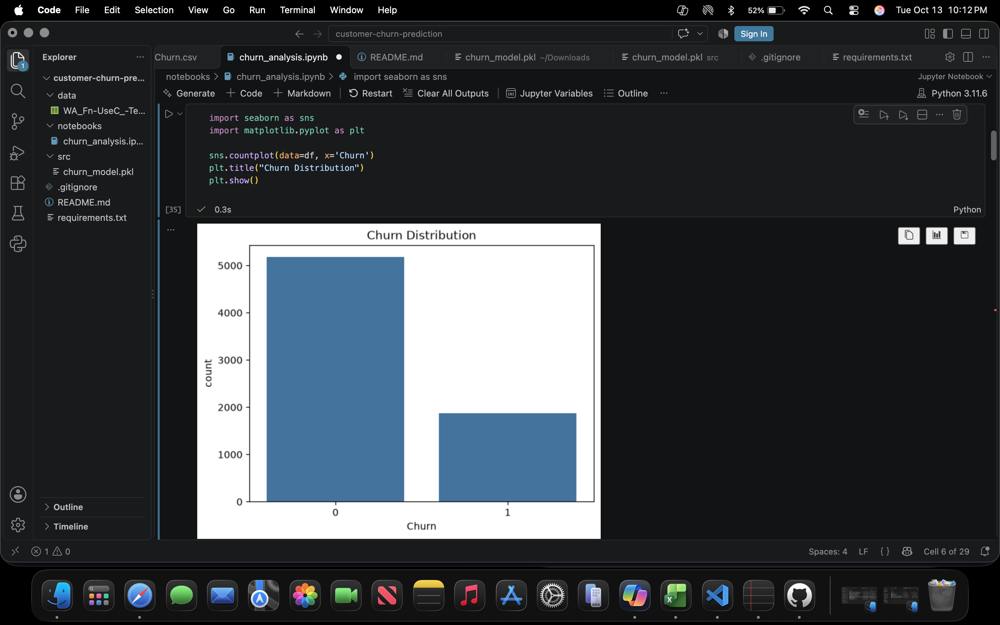
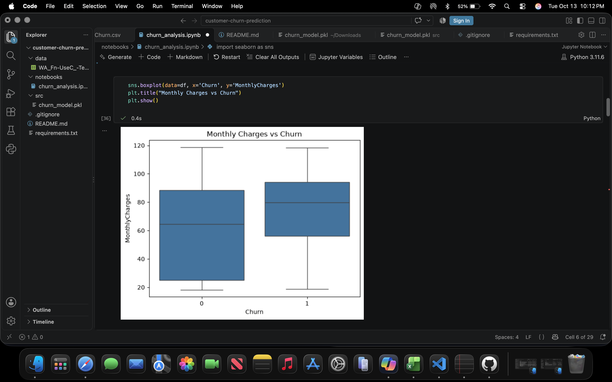
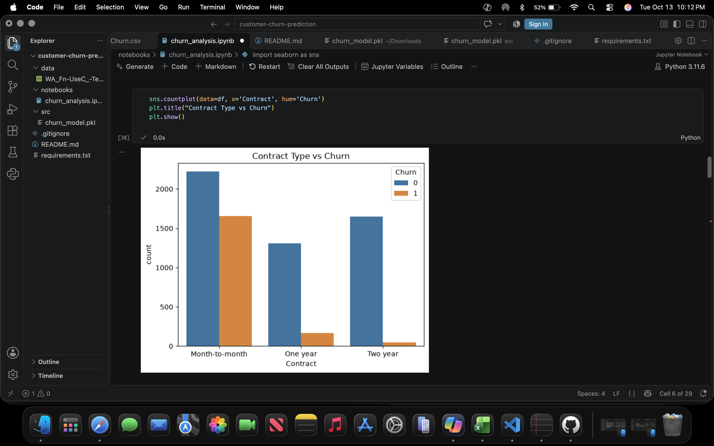
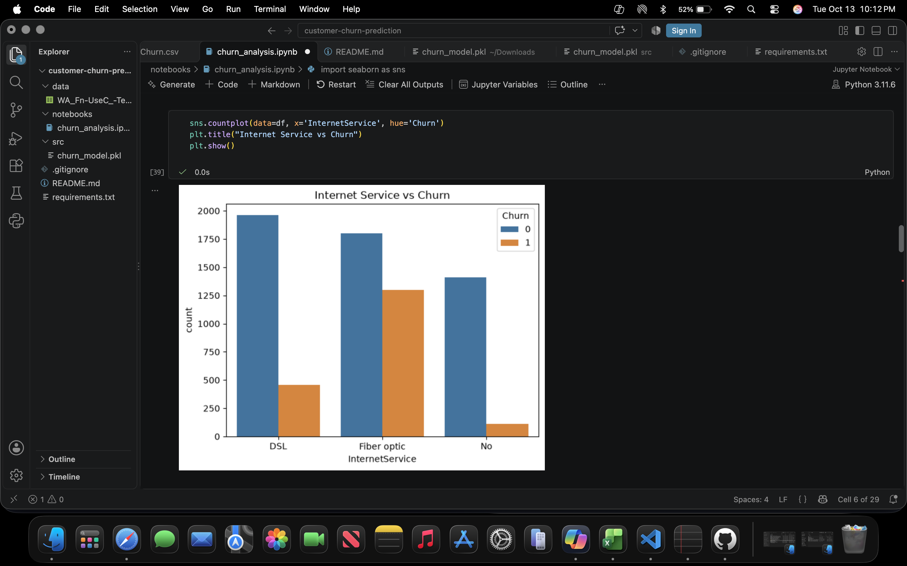
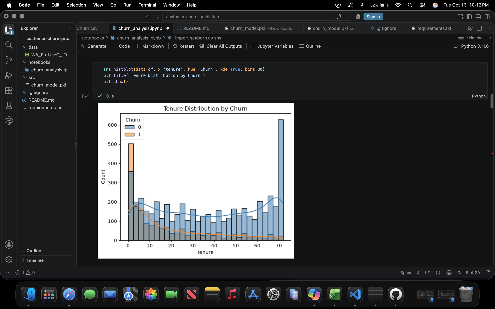
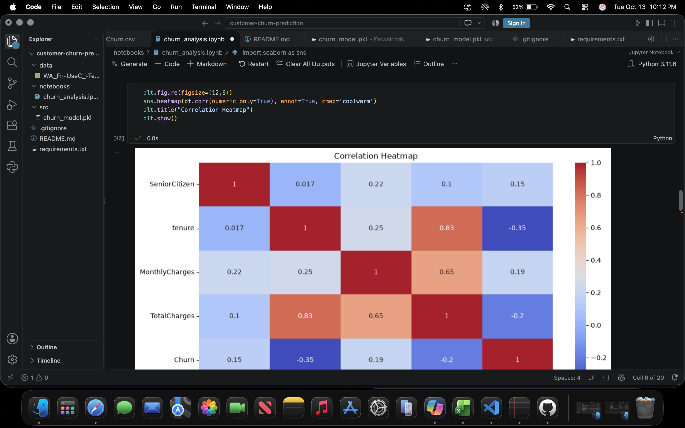
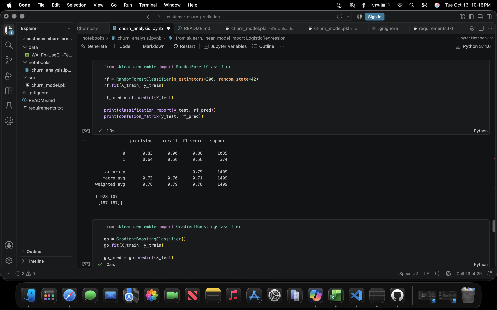
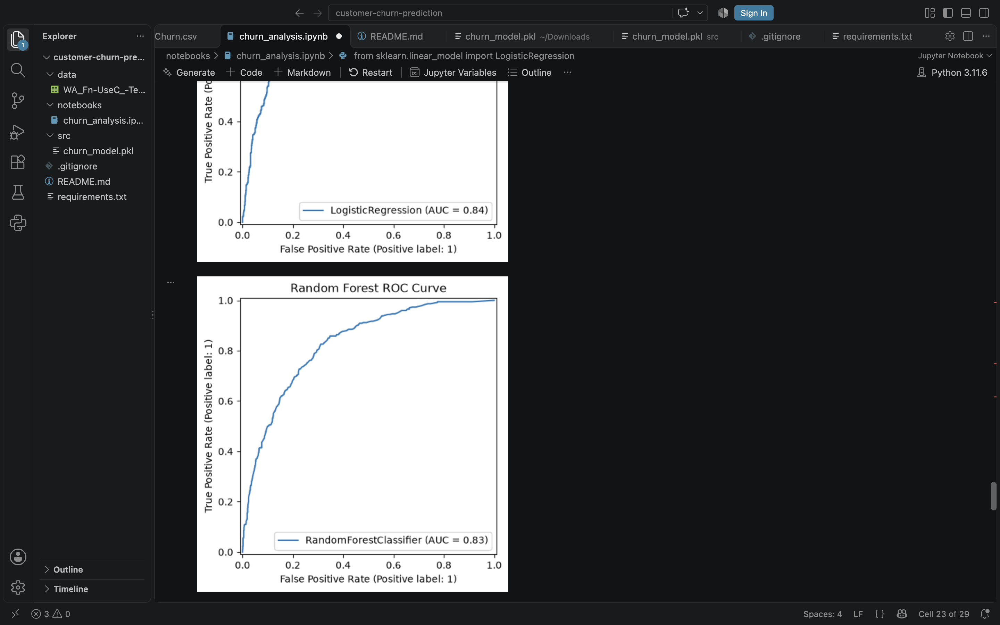
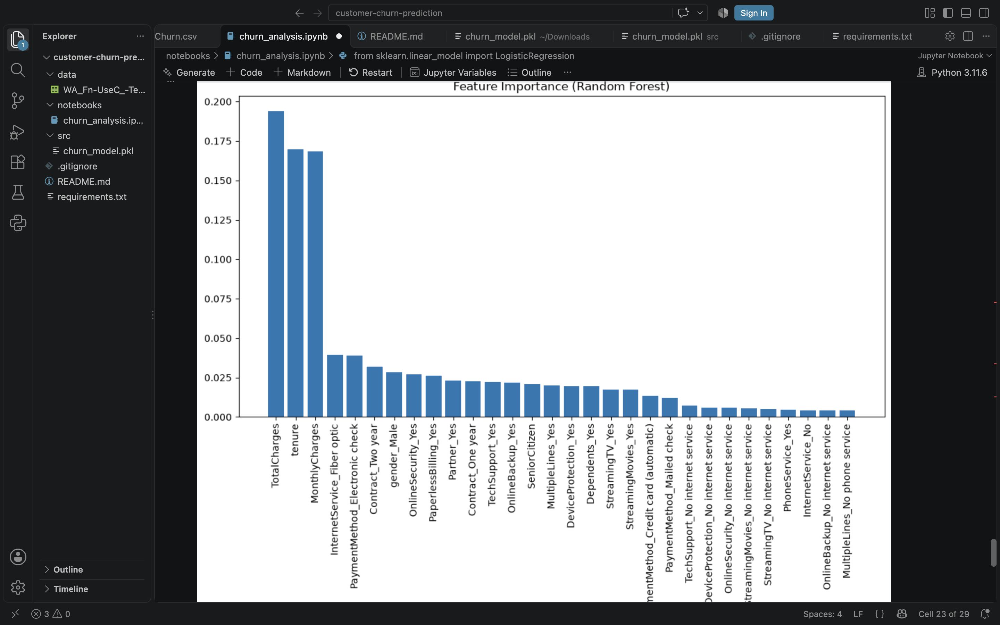

📘 Customer Churn Prediction

A complete end‑to‑end machine learning project analyzing customer behavior and predicting churn using Python, Pandas, Scikit‑Learn, and visual EDA.
This project demonstrates real‑world ML workflow, model comparison, and clear business insights.

🔍 Project Overview

Customer churn is a major challenge for subscription‑based businesses.
This project explores:
• Why customers leave
• Which features influence churn
• How to predict churn using ML
• How to visualize churn patterns
• How to evaluate model performance
The final selected model is Random Forest, chosen after comparing multiple algorithms.

📁 Repository Structure

customer-churn-prediction/
│
├── data/                     # Dataset
├── images/                   # Screenshots for README
├── notebooks/                # Jupyter notebook with full workflow
├── src/                      # Model file and scripts
├── README.md                 # Project documentation
└── requirements.txt          # Dependencies

📊 Exploratory Data Analysis (EDA)

Churn Distribution

Insights:
• Majority of customers did not churn.
• Dataset is imbalanced, requiring careful evaluation of precision/recall.
• Imbalance impacts threshold‑based classification performance.

### Churn Distribution

Monthly Charges vs Churn

Insights:
• Higher monthly charges correlate with higher churn.
• Indicates dissatisfaction with pricing or perceived value.
• Suggests opportunity for pricing optimization.

### Monthly Charges vs Churn

Contract Type vs Churn

Insights:
• Month‑to‑month customers churn the most.
• One‑year and two‑year contracts significantly reduce churn.
• Longer contracts improve customer retention.

### Contract Type vs Churn

Internet Service vs Churn

Insights:
• Fiber Optic customers churn more than DSL users.
• Fiber plans are typically more expensive, contributing to churn.
• Internet service type is a strong predictor of churn.

### Internet Service vs Churn

Tenure vs Churn

Insights:
• Customers with short tenure churn more frequently.
• Long‑term customers show strong loyalty.
• Tenure is one of the most important features.

### Tenure vs Churn

Correlation Heatmap

Insights:
• Tenure is negatively correlated with churn.
• MonthlyCharges has a mild positive correlation.
• Contract type and payment method show meaningful relationships.
• Helps identify feature interactions for modeling.

### Correlation Heatmap

🧪 Model Performance (Random Forest)

Confusion Matrix

Matrix Values:
• True Negatives: 928
• False Positives: 107
• False Negatives: 187
• True Positives: 187
Interpretation:
• Strong performance on predicting non‑churn.
• Predicting churn is more challenging due to dataset imbalance.
• Recall for churn is moderate, which is typical for churn datasets.

### Confusion Matrix

ROC Curve

Insights:
• ROC‑AUC = 0.83, showing strong separation between churn and non‑churn.
• Higher AUC indicates better probability‑based classification.

### ROC Curve

Feature Importance

Top Predictors:
• Tenure
• MonthlyCharges
• Contract Type
• Internet Service
These features strongly influence customer retention.

### Feature Importance

🧠 Model Details

• Final Model: Random Forest Classifier
• Key Features: Tenure, MonthlyCharges, Contract Type, InternetService

Performance Metrics:

Accuracy	0.79
Precision (Churn = 1)	0.64
Recall (Churn = 1)	0.50
F1‑Score (Churn = 1)	0.56
ROC‑AUC	0.83

The trained model is saved as:

src/churn_model.pkl

🚀 How to Run the Project

1. Install dependencies
   pip install -r requirements.txt

2. Run the notebook

  notebooks/churn_analysis.ipynb

3. Load the trained model

   import joblib
   model = joblib.load("src/churn_model.pkl")

🌟 Key Insights

• Month‑to‑month contract customers churn the most.
• Higher monthly charges correlate with higher churn.
• Shorter tenure strongly predicts churn.
• Fiber optic internet customers churn more than DSL.
• Automatic payments reduce churn.

🎯 Project Highlights

• Clean, readable notebook
• Visual EDA with clear business insights
• Full ML pipeline: preprocessing → training → evaluation
• Downloadable trained model
• Professional portfolio structure

📣 About This Project

This project is part of my data‑science portfolio showcasing skills in:
• Python
• Pandas
• Data cleaning
• Visualization
• Machine learning
• Model evaluation
• GitHub project structuring

## 📫 Connect with Me

- LinkedIn: www.linkedin.com/in/ritesh-reddy-podduturi-69391416a

